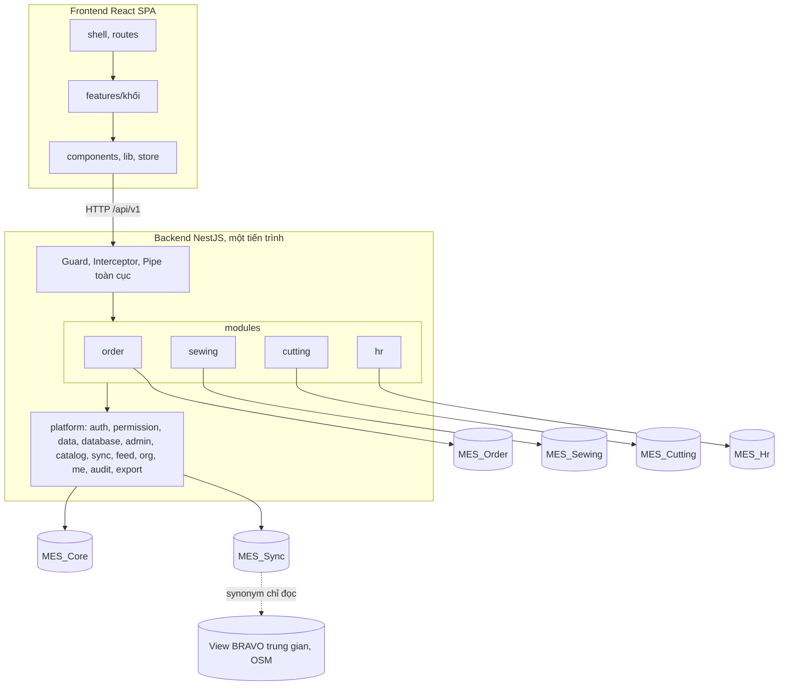
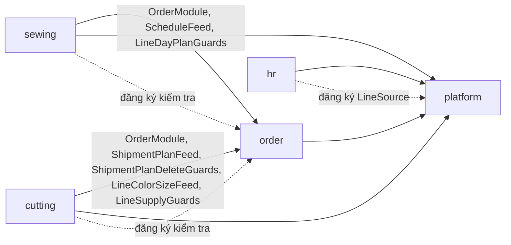

# Kiến trúc

| Mục | Nội dung |
|---|---|
| Mục đích | Mô tả kiến trúc đang tồn tại trong code: layer, module, phụ thuộc, contract dùng chung, database, ranh giới phải bảo vệ, vấn đề còn chờ quyết |
| Đối tượng | Dev, Tech Lead, AI agent trước khi thêm module, bảng, API hoặc đổi cấu trúc |
| Nguồn quy tắc | Quy tắc bắt buộc: [AGENTS.md](../AGENTS.md). Lý do của từng quyết định: [13 Quyết định](update_docs/13-quyet-dinh.md). File này mô tả hiện trạng và chỉ chỗ code |
| Đối chiếu code | Commit `98d19db` trên `main` (19/10/2026) |

Ký hiệu: mọi mục là hiện trạng đã kiểm trong code, trừ chỗ ghi **NEEDS VERIFICATION**, **PROPOSED** hoặc **APPROVED** (đã duyệt, code chưa theo).

## 1. Kiến trúc tổng thể

Modular Monolith: một backend NestJS chạy một tiến trình, một frontend React một trang, SQL Server với mỗi module nghiệp vụ một database.

- Điểm vào backend: `backend/src/main.ts` (`bootstrap`), cấu hình chung ở `backend/src/app.factory.ts` (`configureApp`, dùng cho cả test), module gốc `backend/src/app.module.ts`.
- `--serve-web`: backend phục vụ luôn `frontend/dist` (`backend/src/serve-web.ts`); mọi `GET` không bắt đầu bằng `/api/` hay `/assets/` trả `index.html`.
- Điểm vào frontend: `frontend/src/main.tsx`, `frontend/src/App.tsx`.
- Không có WebSocket, không có hàng đợi ngoài, không có bộ hẹn giờ. Việc chạy nền duy nhất là hàng đợi đồng bộ trong tiến trình ([DATA_FLOWS.md](DATA_FLOWS.md) mục 5).

## 2. Các layer và trách nhiệm

### 2.1 Backend

| Layer | Trách nhiệm | Không được làm | Code |
|---|---|---|---|
| Middleware Express | Đọc JSON (tối đa 512 KB), helmet, cookie-parser | | `app.factory.ts` |
| Guard toàn cục | `AuthGuard`: token, phiên, ĐVCS, tính `UserAccess`. `PermissionGuard`: endpoint phải khai báo quyền | | `platform/auth/auth.guard.ts`, `permission.guard.ts`; đăng ký ở `auth.module.ts` (`APP_GUARD`) |
| Interceptor toàn cục | `FieldPolicyInterceptor`: chặn ghi cột không được sửa, bỏ/che cột khi trả về | | `platform/permission/field-policy.interceptor.ts` (`APP_INTERCEPTOR` ở `permission.module.ts`) |
| Pipe toàn cục | `ValidationPipe` (`whitelist`, `transform`), lỗi 422 `VALIDATION_FAILED` | | `app.factory.ts` |
| Controller | Route, decorator quyền, DTO, gọi một service | Truy vấn DB, luật nghiệp vụ | `*.controller.ts` |
| Service | Luật nghiệp vụ, transaction, gọi repository và API công khai của module khác | SQL thô, tự viết điều kiện phân quyền | `*.service.ts` |
| Repository | Truy vấn bảng của module qua `BaseRepository`/`ChildRepository` (tự lọc ĐVCS, phạm vi, chặn ghi `A00`) | Nhận `BranchCode` từ client | `*.repositories.ts`, `platform/data/base.repository.ts` |
| Bộ lọc lỗi | `AllExceptionsFilter`: mọi lỗi thành `{ error: { code, message, details }, traceId }` | Trả chi tiết nội bộ | `common/http-exception.filter.ts` |

Thứ tự trong một request và các bước kiểm quyền: [DATA_FLOWS.md](DATA_FLOWS.md) mục 1–3.

### 2.2 Frontend

| Layer | Trách nhiệm | Code |
|---|---|---|
| Khởi động, route | Provider, khôi phục phiên, cây route, nạp lười màn theo đường dẫn menu | `main.tsx`, `App.tsx`, `routes/registry.tsx`, `routes/FallbackRoute.tsx` |
| Khung | Layout, menu động, đổi ĐVCS, guard trạng thái đăng nhập, phản chiếu quyền | `shell/*` (`AppLayout`, `BranchSwitcher`, `guards`, `Can`, `permissions`) |
| Màn hình | Một thư mục mỗi khối, gọi API qua `api.ts` của khối | `features/<khối>/*` |
| Dùng chung | Thành phần giao diện, gọi API, định dạng, xác nhận, chống mất dữ liệu | `components/*`, `lib/*` |
| Trạng thái | Phiên chỉ trong bộ nhớ (Zustand); dữ liệu máy chủ qua TanStack Query | `store/session.ts`, `store/auth.ts`, `lib/queryClient.ts` |

Chi tiết từng thành phần: [10 Giao diện](update_docs/10-giao-dien.md).

## 3. Các module

### 3.1 Nền tảng (`backend/src/platform`)

| Khối | Trách nhiệm | Thành phần công khai |
|---|---|---|
| `auth` | Đăng nhập, phiên, token, guard, decorator khai báo quyền; API `/auth` | `decorators.ts`, `AuthUser` (`auth.types.ts`) |
| `permission` (toàn cục) | Tính quyền, phạm vi, phiên bản quyền; ĐVCS; chính sách cột | `PermissionService`, `BranchService`, `FieldPolicyService` |
| `data` (toàn cục) | `BaseRepository`, `ChildRepository`, `ResourceRegistry`, lọc theo cột, `inTransaction` | `base.repository.ts`, `resource-registry.ts`, `column-filter.ts`, `transaction.ts` |
| `database` (toàn cục) | Kết nối `MES_Core` (`CORE_DB`), `createDb` cho database khác | `db.ts` |
| `admin` | API `/admin/*`: người dùng, vai trò, phân quyền, chính sách cột, ĐVCS, nhật ký | – |
| `catalog` (toàn cục) | API `/admin/catalogs/*`: danh mục, Nhà máy SX, ca, Lịch làm việc | `CatalogLookupService`, `factory-list.ts`, `work-calendar.ts` |
| `sync` | Đồng bộ BRAVO, OSM vào `MES_Sync`; API `/admin/sync/*` | Chỉ nền tảng dùng (module bị lint chặn) |
| `feed` (toàn cục) | Cổng chỉ đọc dữ liệu đã chép cho module; đăng ký việc chạy sau đồng bộ | `SourceFeedService` |
| `org` (toàn cục) | Chuyền may (nguồn do module đăng ký), tên người dùng | `OrgService`, `LineSource`, `UserDirectoryService` |
| `me` | API `/me/*`: thông tin, menu, quyền, chính sách cột của phiên | – |
| `audit` (toàn cục) | Ghi `SysAuditLog` | `AuditService` |
| `export` (toàn cục) | Xuất CSV theo chính sách cột | `ExportService` |

"Toàn cục" là module đánh `@Global()` (`audit`, `catalog`, `data`, `database`, `export`, `feed`, `org`, `permission`).

### 3.2 Nghiệp vụ (`backend/src/modules`)

| Module | Database | Controller | Xuất cho module khác | Tài liệu |
|---|---|---|---|---|
| `order` | `MES_Order` | `order.controller.ts` (`/order/*`, 48 route) | `ScheduleFeed`, `ShipmentPlanFeed`, `ShipmentPlanDeleteGuards`, `LineColorSizeFeed`, `LineSupplyGuards`, `LineDayPlanGuards` (`order.module.ts`) | [06](update_docs/06-don-hang.md) |
| `sewing` | `MES_Sewing` | `sewing.controller.ts` (`/sewing/*`, 15 route) | – | [07](update_docs/07-may.md) |
| `cutting` | `MES_Cutting` | `cutting.controller.ts` (`/cutting/progress`, `/cutting/supply`, 17 route) | – | [15](update_docs/15-cat.md) |
| `hr` | `MES_Hr` | `hr.controller.ts` (`/hr/*`, 20 route) | Không xuất; đăng ký `HrLineSource` vào `OrgService` | [08](update_docs/08-nhan-su.md) |

Mỗi module theo khuôn: `<module>.module.ts`, `<module>.controller.ts`, `*.service.ts`, `<module>.repositories.ts`, `<module>.dto.ts`, `<module>.types.ts` (kiểu bảng), `<module>.db.ts` (kết nối riêng, tự đóng khi tắt ứng dụng), migration ở `backend/migrations/MES_<Module>/`. Số route đếm từ decorator trong controller (19/10/2026).

## 4. Quan hệ phụ thuộc

Mũi tên liền là import; mũi tên chấm là **đăng ký ngược**: module phụ thuộc đăng ký hàm vào service của module được phụ thuộc, để chiều import giữ một chiều.

| Đăng ký ngược | Ai đăng ký | Vào đâu | Để làm gì |
|---|---|---|---|
| `LineSource` | `hr` (`HrLineSource.onModuleInit`) | `OrgService.registerSource` | Nền tảng đọc chuyền may mà không import module Nhân sự |
| `ShipmentPlanDeleteGuards` | `cutting` (`CuttingProgressService.onModuleInit`) | `order` | Chặn xóa kế hoạch xuất hàng đã có số cắt |
| `LineSupplyGuards` | `cutting` (`CuttingSupplyService.onModuleInit`) | `order` | Chặn giảm phần giao dưới số BTP đã cấp |
| `LineDayPlanGuards` | `sewing` (`SewingPlanService`) | `order` | Chặn bỏ, đổi chuyền, giảm dòng dàn chuyền đã có Kế hoạch may |

Luật import cưỡng chế bằng `no-restricted-imports` ở `backend/eslint.config.mjs`, chạy trong `npm run lint`:

| Khối luật | Được import từ module khác | Bị cấm |
|---|---|---|
| `src/modules/sewing/**` | `order.module`, `schedule-feed.service`, `line-day-plan-guard` | Phần còn lại của `order`; `hr`; `platform/sync` |
| `src/modules/cutting/**` | `order.module`, `shipment-plan-feed.service`, `shipment-plan-delete-guard`, `line-color-size-feed.service`, `line-supply-guard` | Phần còn lại của `order`; `sewing`; `hr`; `platform/sync` |
| `src/modules/order/**` | – | `sewing`, `cutting`, `hr`, `platform/sync` |
| `src/modules/hr/**` | – | `order`, `sewing`, `cutting`, `platform/sync` |
| `src/platform/**` | – | Mọi thứ trong `modules` |

Module dùng thành phần công khai của nền tảng (đếm import trong `backend/src/modules`): `data/base.repository`, `auth/auth.types`, `audit/audit.service`, `data/transaction`, `catalog/catalog-lookup.service`, `permission/field-policy.service`, `data/column-filter`, `export/export.service`, `org/org.service`, `data/resource-registry`, `feed/source-feed.service`, `database/db`, `catalog/factory-list`, `auth/decorators`, `org/user-directory.service`, `permission/permission.service`, `permission/branch.service`, `catalog/work-calendar`, `org/line-source`. Không module nào import `platform/sync` hay đọc thẳng `CORE_DB`.

Frontend không có luật import: `features/admin` import `features/hr`, `features/sewing`. Màn Cắt, May không còn import `features/order`: phần dùng chung nằm ở `components`, `lib`, `shell` (T9, 21/10/2026; xem mục 8).

## 5. Thành phần dùng chung và contract

### 5.1 Contract HTTP

| Contract | Hiện trạng | Code |
|---|---|---|
| Tiền tố | `/api/v1` (không bật versioning của Nest, không có CORS) | `app.factory.ts` |
| Khai báo quyền | Mỗi endpoint có `@Public`, `@Authenticated` hoặc `@RequirePermission('module.resource:action')`; không có thì 403 `ENDPOINT_NOT_DECLARED` | `platform/auth/decorators.ts`, `permission.guard.ts` |
| Chính sách cột | Endpoint của màn có cột đăng ký đặt `@FieldResource('<tài nguyên>')` | `decorators.ts`, `field-policy.interceptor.ts` |
| Dữ liệu vào | DTO `class-validator`; trường thừa bị bỏ | `*.dto.ts` |
| Lỗi | `{ error: { code, message, details }, traceId }`, mã ổn định ở `Errors` | `common/app.exception.ts`, `common/http-exception.filter.ts` |
| Phiên bản quyền | Header `X-Permission-Version` trên response có access token; frontend thấy đổi thì tải lại quyền | `auth.guard.ts`, `frontend/src/lib/api.ts` |
| Phân trang | `page`, `pageSize` (tối đa 200), lọc theo cột `cf` (JSON) | `BaseRepository.list`, DTO của từng màn |

Danh sách endpoint theo khối: tài liệu module (`/auth` ở [04](update_docs/04-phan-quyen.md), `/admin/*`, `/me/*` ở [05](update_docs/05-quan-tri-he-thong.md), `/admin/sync/*` ở [09](update_docs/09-dong-bo.md), `/order/*` ở [06](update_docs/06-don-hang.md), `/sewing/*` ở [07](update_docs/07-may.md), `/cutting/*` ở [15](update_docs/15-cat.md), `/hr/*` ở [08](update_docs/08-nhan-su.md)).

### 5.2 Thành phần backend dùng chung

| Thành phần | Dùng để | Code |
|---|---|---|
| `BaseRepository<R>`, `ChildRepository<R>` | Truy vấn bảng nghiệp vụ có lọc ĐVCS, phạm vi, chặn ghi `A00`, khóa dòng | `platform/data/base.repository.ts` |
| `scopeOf(user)` | Dựng `Scope` của request từ `AuthUser` | `base.repository.ts` |
| `ResourceRegistry` | Đọc `SysResource` (bảng nguồn, chiều phạm vi, cột đăng ký); từ chối tài nguyên chưa khai | `platform/data/resource-registry.ts` |
| `inTransaction(db, fn)` | Transaction giữ lỗi gốc khi SQL Server tự rollback | `platform/data/transaction.ts` |
| `createDb(database, opts)` | Kết nối Kysely cho một database (pool tối đa 10) | `platform/database/db.ts` |
| `AppException`, `Errors` | Lỗi có mã ổn định | `common/app.exception.ts` |
| `FieldPolicyService`, `ExportService`, `AuditService` | Chính sách cột, xuất file, nhật ký | `platform/permission`, `platform/export`, `platform/audit` |

### 5.3 Thành phần frontend dùng chung

| Thành phần | Dùng để | Code |
|---|---|---|
| `api()`, `ApiError` | Gọi API kèm token, làm mới phiên một lần khi 401, đọc `X-Permission-Version` | `lib/api.ts` |
| `DataGrid`, `SheetGrid` | Lưới xem (lọc theo cột, chính sách cột); lưới nhập kiểu bảng tính | `components/DataGrid.tsx`, `components/SheetGrid.tsx` |
| `useCan`, `<Can>`, `useFieldPolicy` | Ẩn/hiện theo quyền, cột | `shell/permissions.ts`, `shell/Can.tsx`, `lib/fieldPolicy.ts` |
| `toastError`, `toastOk`, `confirmAction` | Thông báo, hộp xác nhận | `lib/notify.ts`, `lib/confirm.tsx` |
| Phần dùng chung của các màn danh sách | `components/StatusBadge.tsx`, `EmptyState.tsx`, `ExportButton.tsx`, `OrderFilters.tsx`; `lib/pagedList.ts` (`usePagedList`, `OrderFilter`, `emptyFilter`), `lib/orderOptions.ts` (`useCustomers`), `lib/lines.ts` (`useLines`, `useLinesState`), `lib/notify.ts` (`loadError`), `lib/fieldPolicy.ts` (`readable`); `useCanWrite` ở `shell/permissions.ts`, `PICK_ROW` ở `components/ActionButton.tsx` | CURRENT (T9, 21/10/2026). `features/order/common.tsx` chỉ còn phần riêng của Đơn hàng (bảng trạng thái, `IssueList`, `useOriginLock`) |

## 6. Database

### 6.1 Danh sách

Tên thật đặt qua biến môi trường (mặc định như cột đầu; `backend/scripts/database-names.ts`, `backend/src/config/env.ts`).

| Database | Biến | Sở hữu | Nội dung |
|---|---|---|---|
| `MES_Core` | `DB_CORE_NAME` | nền tảng | Người dùng, vai trò, quyền, phiên, nhật ký, menu, tài nguyên, ĐVCS, danh mục, Nhà máy SX, Lịch làm việc |
| `MES_Order` | `DB_ORDER_NAME` | `order` | Đơn hàng, PO, màu cỡ, kế hoạch xuất hàng, xếp chuyền, Phân bổ PO |
| `MES_Sewing` | `DB_SEWING_NAME` | `sewing` | Kế hoạch chuẩn bị SX, bước chuẩn bị, Kế hoạch may |
| `MES_Cutting` | `DB_CUTTING_NAME` | `cutting` | Bản chép kế hoạch xuất hàng, số cắt theo ngày, lệnh cấp BTP |
| `MES_Hr` | `DB_HR_NAME` | `hr` | Loại phòng ban, phòng ban (gồm chuyền may), chức danh, nhân viên |
| `MES_Sync` | `DB_SYNC_NAME` | `platform/sync` | Bảng chép BRAVO (`bravo.*`), OSM (`osm.*`), `SyncSource`, `SyncRun`, thủ tục chép |

Bảng của từng database: tài liệu module (04, 05 cho `MES_Core`; 06, 07, 15, 08, 09 cho các database còn lại).

### 6.2 Migration

- File `backend/migrations/<Database>/NNNN_ten.sql`, chạy bằng `backend/scripts/migrate.ts` theo thứ tự tên; mỗi file một transaction, tách lô theo `GO`; tên file đã chạy ghi ở `dbo.__MigrationHistory` của database đó, không có checksum, không có migration lùi.
- Danh sách file dưới đây (19/10/2026: `MES_Core` 14 file, `MES_Order` 9, `MES_Sewing` 4, `MES_Cutting` 3, `MES_Hr` 2, `MES_Sync` 7). Thêm migration thì thêm dòng vào bảng này; cột, bảng chi tiết ở tài liệu module.

| Database | File | Nội dung |
|---|---|---|
| `MES_Core` | `0001_init` | Bảng lõi: người dùng, ĐVCS, vai trò, quyền, menu, tài nguyên, phiên, nhật ký, chính sách cột, ngoại lệ, phiên bản quyền |
| | `0002_scope_field_override` | Phân quyền phạm vi (cây `SysOrgUnit`, chiều phạm vi, phạm vi theo phép gán), cột đăng ký, nhật ký đọc dữ liệu nhạy cảm; chỉ một đơn vị tổng hợp |
| | `0003_catalog` | Danh mục hệ thống: `SysCatalog`, `SysCatalogItem`, `SysShift` |
| | `0004_move_prep_to_order` | Đổi mã tài nguyên `sewing.prep` → `order.prep`, đường dẫn `/sewing/prep` → `/order/prep` (giữ Id) |
| | `0005_org_workshop` | Cây tổ chức thêm cấp Xưởng: gốc → Xưởng → Chuyền, ràng buộc cấp trong database |
| | `0006_org_path_guard` | Siết ràng buộc cấp và đường dẫn (`Path`) của cây tổ chức |
| | `0007_production_factory` | `SysBranch` thành Đơn vị cơ sở; danh mục Nhà máy SX `SysProductionFactory`; bảng `SysUserProductionFactory` |
| | `0008_factory_code_osm` | Mã Nhà máy SX là tên nhà máy OSM (`NVARCHAR(100)`, không dấu phẩy, không khoảng trắng đầu cuối) |
| | `0009_line_scope_by_code` | Phạm vi chiều Chuyền theo mã bộ phận (chiều giá trị): chuyển phạm vi cũ theo nút cây tổ chức sang mã, ngừng nút Xưởng, Chuyền của `SysOrgUnit`, nhật ký, tăng phiên bản quyền. Dừng backend trước khi chạy; chạy cùng bản build có nguồn chuyền mới ([Vận hành](update_docs/11-van-hanh.md)) |
| | `0010_grant_poallocation_update` | Máy đã cài: cấp `order.poallocation:update` cho vai trò hệ thống Kế hoạch, Toàn quyền; đặt bảng nguồn `PoAllocation`; nhật ký `ROLE_PERMISSIONS`; tăng phiên bản quyền. Database chưa seed: không làm gì |
| | `0011_work_calendar` | Lịch làm việc theo ĐVCS: `SysWorkCalendar`, `SysWorkCalendarDay` (phase 5.12) |
| | `0012_grant_cutting_progress` | Máy đã cài: cấp `cutting.progress` Sửa, Xuất cho vai trò hệ thống Kế hoạch khi vai trò còn quyền Xem (không cấp cho Toàn quyền: đã có từ seed); nhật ký `ROLE_PERMISSIONS` cùng dạng màn Vai trò; tăng phiên bản quyền khi có cấp. Bảng nguồn `CuttingPlan` do seed đặt. Database chưa seed: không làm gì |
| | `0013_grant_cutting_supply` | Máy đã cài: cấp `cutting.supply` Thêm, Sửa, Xóa, Xuất cho vai trò hệ thống Kế hoạch khi vai trò còn quyền Xem (như `0012`); nhật ký `ROLE_PERMISSIONS`; tăng phiên bản quyền khi có cấp. Bảng nguồn `CuttingSupply` do seed đặt. Database chưa seed: không làm gì |
| | `0014_work_calendar_rounding` | Cột `SysWorkCalendar.ProductionRoundUpFrom`: ngưỡng làm tròn Số ngày SX (5.12.3) |
| | `0015_mask_cutting_progress_customer` | Máy đã cài: chính sách cột Che `customerName` của `cutting.progress` cho vai trò hệ thống Trưởng chuyền khi vai trò chưa có chính sách cho cột này (T16, Q51); nhật ký `ROLE_FIELD_POLICY`; tăng phiên bản quyền khi có thêm. Database chưa seed: không làm gì |
| `MES_Order` | `0001_order_init` | Bảng đơn hàng, PO, màu cỡ, kế hoạch xuất hàng, xếp chuyền; khóa ngoại ghép `(…, BranchCode)` |
| | `0002_order_owner_index` | Chỉ mục `CreatedBy` cho phạm vi "do mình tạo" |
| | `0003_order_bravo_source` | Nhận dữ liệu BRAVO: nới mã hàng, tên màu; khóa nguồn |
| | `0004_sales_order_factory` | Cột Nhà máy SX của đơn hàng |
| | `0005_shared_sales_order` | Đơn hàng, PO dùng chung toàn công ty; kế hoạch nối đơn hàng theo `Id` |
| | `0006_sales_order_source_hash` | `SourceHash` cho bước nạp tăng dần |
| | `0007_factory_osm_po_number` | Nhà máy SX là danh sách mã theo OSM; `PoNumber NVARCHAR(192)` |
| | `0008_po_used_by_plan_branch` | Khóa ngoại PO → đơn hàng theo `Id`; chỉ mục PO trong kế hoạch theo ĐVCS |
| | `0009_po_allocation` | Bảng làm việc Phân bổ PO `PoAllocation` (Nhà máy SX nhập tay) và bảng trạng thái lần làm mới `PoAllocationRefresh` |
| `MES_Sewing` | `0001_sewing_prep` | Danh mục bước chuẩn bị, kế hoạch chuẩn bị SX và ngày từng bước |
| | `0002_sewing_prep_source` | Nhận diện dòng dàn chuyền nguồn chắc hơn; chỉ mục khóa ngầm |
| | `0003_sewing_day_plan` | Kế hoạch may: `SewingDayPlan` (một chuyền, một ngày, trạng thái chốt; `LineCode NVARCHAR(20)`), `SewingDayPlanItem` (một dòng dàn chuyền trong ngày: số nhập và bản chụp từ Xếp chuyền; xóa theo cha) |
| | `0004_sewing_day_plan_item_created_by` | Chỉ mục khóa ngầm `SewingDayPlanItem.CreatedBy` |
| `MES_Cutting` | `0001_cutting_progress` | `CuttingPlan` (bản chép đầu kế hoạch; mất nguồn mà còn số cắt thì `ShipmentPlanId = NULL`, `SourceDeletedAt`), `CuttingPlanColorSize`, `CuttingPlanDaily` (một dòng mỗi kế hoạch, màu, cỡ, ngày; `Qty > 0`); khóa ngoại ghép `(CuttingPlanId, BranchCode)`: bảng màu cỡ chép xóa theo cha, bảng số cắt không (lỡ xóa kế hoạch còn số cắt thì database từ chối). Database phải cùng collation với `MES_Core`, `MES_Order` |
| | `0002_cutting_supply` | `CuttingSupply` (lệnh cấp BTP, một lệnh mỗi ĐVCS, Ngày cấp, mã hàng; số lệnh theo ĐVCS và năm), `CuttingSupplyLine` (số cấp theo chuyền, màu, cỡ; `Qty > 0`; xóa theo lệnh) |
| | `0003_cutting_supply_indexes` | Chỉ mục `CuttingSupply (CreatedBy)`, `(ConfirmedBy)` (có lọc NOT NULL), `CuttingPlan (BranchCode, StyleCode)` |
| `MES_Hr` | `0001_hr_init` | Loại phòng ban, phòng ban, chức danh, nhân viên |
| | `0002_department_production_workshop` | Cột `Department.IsProductionWorkshop` (bộ phận là chuyền may), bắt buộc có ĐVCS khi tích, chỉ mục có lọc cho nguồn chuyền |
| `MES_Sync` | `0001_sync_core` | `SyncSource`, `SyncRun`, thủ tục điều phối |
| | `0002_bravo_order_sources` | 18 bảng chép BRAVO (đơn hàng, PO, màu cỡ, danh mục) và thủ tục chép (sinh tự động) |
| | `0003_sync_procs_name_columns` | Sửa thủ tục chép (lỗi 8155) |
| | `0004_sync_guard_keys_mass_delete` | Thủ tục chép dừng khi khóa NULL/trùng hoặc xóa quá 20% bảng |
| | `0005_osm_factory_source` | Nguồn OSM `vOSMDataFty` → `osm.OSMDataFty` |
| | `0006_sync_execute_osm` | Thủ tục điều phối chạy được nguồn schema `osm` |
| | `0007_osm_po_allocation` | Nguồn OSM `v_OSMData` → `osm.OSMData` (màn Phân bổ PO) |

- Migration `MES_Sync` có phần sinh bằng `backend/scripts/sync-gen.ts`; sau mỗi lần migrate `MES_Sync`, script tạo lại synonym trỏ tới database nguồn theo `.env`.
- Cách chạy, chốt chặn: [ENGINEERING_STANDARDS.md](ENGINEERING_STANDARDS.md) mục 6, [11 Vận hành](update_docs/11-van-hanh.md).

### 6.3 Quan hệ giữa các database

- Khóa ngoại vật lý chỉ trong cùng database. Cột trỏ sang database khác là **khóa ngầm**, khai ở `backend/migrations/softkeys.json` (nguồn duy nhất của danh sách), có chỉ mục, kiểm bằng `npm run check:softkeys -w backend` (chỉ đọc, thoát mã 1 khi có bản ghi mồ côi).
- Các loại khóa ngầm đang có: `BranchCode` của mọi bảng theo ĐVCS → `MES_Core.SysBranch.Code`; `CreatedBy`, `ModifiedBy`, `ConfirmedBy`, `LockedBy` → `MES_Core.SysUser.Id`; `LineCode` → `MES_Hr.Department.Code` (cùng ĐVCS); bản chép của module May, Cắt → `MES_Order.ShipmentPlan.Id`, `ShipmentPlanLine.Id` (cùng ĐVCS); `SalesOrder.ProductionFactoryCode` → `MES_Core.SysProductionFactory.Code` (danh sách mã).
- **Không có transaction chung giữa các database.** Cách code giữ nhất quán: [DATA_FLOWS.md](DATA_FLOWS.md) mục 4.

## 7. Ranh giới cần bảo vệ

Quy tắc bắt buộc ở [AGENTS.md](../AGENTS.md) mục 3–6. Bảng dưới cho biết ranh giới nào đang được công cụ cưỡng chế.

| Ranh giới | Cưỡng chế bằng | Tự động? |
|---|---|---|
| Module không import phần bên trong module khác; nền tảng không import module; module không import `platform/sync` | `backend/eslint.config.mjs` | Có, khi chạy `npm run lint` |
| Endpoint phải khai báo quyền | `PermissionGuard` lúc chạy; `test/auth.spec.ts` (`ENDPOINT_NOT_DECLARED`) | Lúc chạy: có. Chưa có test quét toàn bộ route |
| `BranchCode` chỉ từ token; lọc ĐVCS, phạm vi, chặn ghi `A00` | `AuthGuard`, `scopeOf`, `BaseRepository`; `test/phase3.spec.ts`, `phase5.spec.ts`, `full-access.spec.ts` | Lúc chạy: có. Test chạy khi gọi `npm test` |
| Truy vấn nghiệp vụ chỉ qua repository | Review | Không |
| Tài nguyên phải khai ở `SysResource` đúng bảng nguồn | `ResourceRegistry.resolve` (500 `RESOURCE_NOT_REGISTERED`) | Lúc chạy |
| Khóa ngoại chỉ trong một database; khóa ngầm có khai báo | `check:softkeys` kiểm dữ liệu mồ côi; chưa có bước báo cột mới chưa khai | Một phần, thủ công |
| Schema chỉ đổi qua migration mới | `migrate.ts` chạy file mới; không chặn sửa file cũ | Không |
| Frontend: ranh giới giữa `features/*` | Không có | Không |

## 8. Kiến trúc frontend

- Ứng dụng một trang. `App.tsx`: `/login`, `/select-branch` (đường dẫn cũ, chuyển về `/`), `/` Trang chủ, còn lại qua `FallbackRoute`: đường dẫn có trong menu và đã đăng ký thì nạp lười màn (`React.lazy` + `withChunkRecovery`), có trong menu mà chưa có màn thì trang giữ chỗ, thuộc module (`MODULE_PREFIXES`) mà không có trong menu thì 403, còn lại 404.
- Vite chạy cổng 5173 khi phát triển, chuyển `/api` sang `http://localhost:3000` để cookie refresh (`SameSite=Strict`) cùng origin (`frontend/vite.config.ts`).
- Không có biến môi trường frontend; phiên bản ứng dụng đưa vào bằng `define: __APP_VERSION__` (`vite.config.ts`, `env.d.ts`).
- Giao diện chỉ ẩn/hiện; mọi kiểm soát quyền nằm ở backend.
- Phần dùng chung của các màn danh sách (dải lọc, danh sách phân trang, nút Xuất file…) nằm ở `components`, `lib` (T9, 21/10/2026), không nằm trong một nhóm màn.

## 9. Triển khai

- Máy chủ Windows chạy backend kèm giao diện (`--serve-web`) bằng pm2, cluster một tiến trình (`deploy/ecosystem.config.cjs`).
- `deploy/deploy.cjs` chép một commit ra `releases\<thời điểm>`, `npm ci` + build trong lúc bản cũ chạy, migrate, trỏ junction `current`, `pm2 reload`; giữ 3 bản để `--rollback` (không migrate lùi). Quy trình: [11 Vận hành](update_docs/11-van-hanh.md); quyết định: [13](update_docs/13-quyet-dinh.md) mục 1.7.
- Việc lúc khởi động (nạp đơn hàng BRAVO, Nhà máy SX theo OSM, làm mới Phân bổ PO) khóa bằng `sp_getapplock`, nên hai tiến trình chạy chồng lúc reload không làm trùng.

## 10. Vấn đề kiến trúc cần quyết định

Quyết định đã ghi mà code chưa làm hoặc làm khác: bảng "Quyết định chưa khớp code" ở [13 Quyết định](update_docs/13-quyet-dinh.md). Các vấn đề dưới đây là hiện trạng thấy khi đối chiếu ngày 19/10/2026, chưa có quyết định; theo dõi ở [current/STATUS.md](current/STATUS.md).

| # | Vấn đề | Hiện trạng | Trạng thái |
|---|---|---|---|
| A1 | Repository không kế thừa `BaseRepository` trong module: `HrCatalogRepository`, `PrepStepRepository`, `ShipmentPlanPriceRepository`, `ShipmentPlanFeedRepository`, `LineColorSizeFeedRepository`, `BravoOrderImportRepository`, `PoAllocationRefreshRepository`; `HrLineSource` đọc thẳng bảng `Department`. Service nền tảng (`admin`, `auth`, `catalog`, `me`, `permission`) truy vấn thẳng `MES_Core`, có chỗ dùng SQL thô | Tech Lead chốt 19/10/2026: **nợ kỹ thuật**, không phải quy tắc được phép | Nợ kỹ thuật |
| A2 | Ranh giới import ở frontend | Không có luật; có import chéo giữa `features/*` | PROPOSED (câu Q29 ở STATUS) |
| A3 | Thư viện dùng chung của màn nghiệp vụ nằm trong `features/order` | Đã chuyển sang `components`, `lib` | Xong (T9, 21/10/2026) |
| A4 | Hạ tầng sự kiện giữa module, module báo cáo xuyên database (`MES_Report`) | Chưa có (13, "chưa khớp" #3, #4) | Chờ quyết |
| A5 | TypeScript 6.0.3 | `backend`, `frontend` khai `~6.0.3`; `nest build`, `tsc`, `ts-jest` cùng dùng 6.0.3 | Xong (T3, 21/10/2026) |
| A6 | CI | `.github/workflows/ci.yml` (GitHub Actions) | Workflow có (T2, 21/10/2026), các bước ở [ENGINEERING_STANDARDS.md](ENGINEERING_STANDARDS.md) mục 9; lần chạy đầu trên GitHub: NEEDS VERIFICATION |
