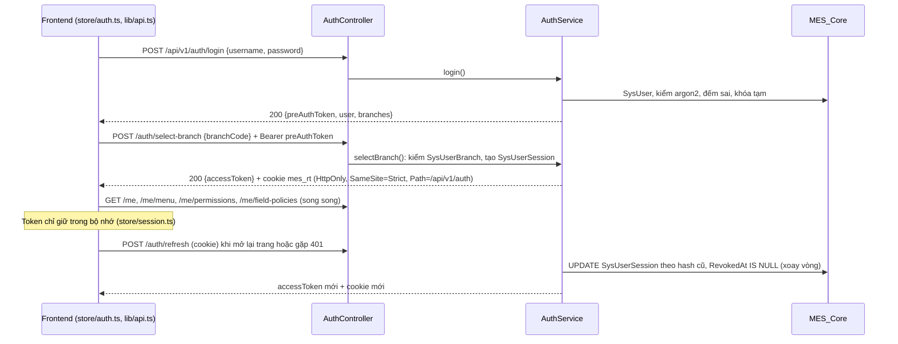
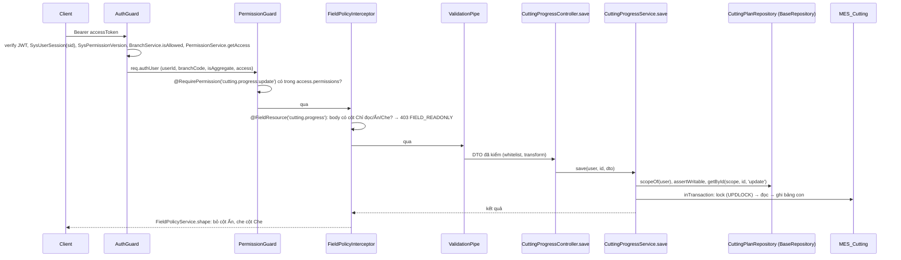
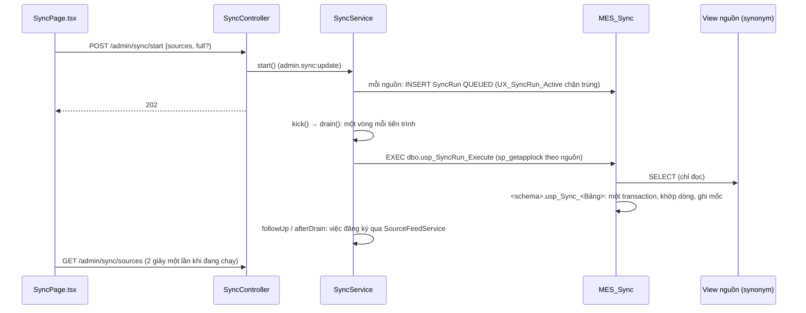

# Luồng dữ liệu

| Mục | Nội dung |
|---|---|
| Mục đích | Mô tả các luồng dữ liệu quan trọng đã truy vết trong code: điểm bắt đầu, thứ tự gọi, dữ liệu vào ra, điểm kiểm quyền, lỗi |
| Đối tượng | Dev, reviewer, AI agent khi sửa luồng đăng nhập, đọc ghi dữ liệu, xuyên module, đồng bộ |
| Không chứa | Luật nghiệp vụ từng màn (tài liệu module), bảng chi tiết của từng lớp phân quyền ([04 Phân quyền](update_docs/04-phan-quyen.md)) |
| Đối chiếu code | Commit `98d19db` trên `main` (19/10/2026) |

Đường dẫn code tính từ gốc repo. Tên hàm ghi theo code; số dòng không ghi vì dễ lệch khi code đổi.

## 1. Đăng nhập, phiên, đổi ĐVCS

| Bước | Code | Vào → ra | Kiểm quyền, lỗi |
|---|---|---|---|
| Đăng nhập | `backend/src/platform/auth/auth.controller.ts`, `AuthService.login`; giao diện `frontend/src/features/auth/LoginPage.tsx` → `store/auth.ts` (`login`) | Tên, mật khẩu → `preAuthToken` (JWT `typ = 'pre'`, mặc định 300 giây), danh sách ĐVCS | `@Public`. 401 `INVALID_CREDENTIALS`; đủ `LOGIN_MAX_FAILED` lần thì 423 `ACCOUNT_LOCKED`; ghi `LOGIN`, `LOGIN_FAILED`, `LOGIN_LOCKED` |
| Chọn ĐVCS | `AuthService.selectBranch`; `store/auth.ts` (`selectBranch`) | `branchCode` (yêu cầu chọn, không phải tham số lọc) → `accessToken` (claim `br`, `sid`, mặc định 900 giây), cookie refresh | `@Authenticated` + `@AllowPreAuth`. 403 `BRANCH_NOT_ALLOWED` khi ĐVCS không có trong `SysUserBranch`; ghi `SELECT_BRANCH` |
| Nạp quyền | `store/auth.ts` (`fetchAccess`): `/me`, `/me/menu`, `/me/permissions`, `/me/field-policies` | → thông tin, menu theo quyền, mã quyền, chính sách cột của phiên | `@Authenticated` (cả `MeController`) |
| Làm mới phiên | `AuthService.refresh`; `lib/api.ts` (`refreshSession`) | Cookie `mes_rt` → access token mới | `@Public`. Hai request cùng token thì một bên 401; lỗi dưới 500 thì xóa cookie |
| Đổi ĐVCS | Lại `POST /auth/select-branch` bằng access token; `shell/BranchSwitcher.tsx` | Thu hồi phiên cũ, tạo phiên mới | Giao diện chặn request của màn cũ trong lúc đổi (`duringBranchSwitch`), xóa cache truy vấn |
| Đăng xuất | `POST /auth/logout` | Thu hồi phiên theo cookie, 204 | `@Public`, không cần access token |

Chi tiết token, cookie, khóa tài khoản, khi nào phiên mất hiệu lực: [04 Phân quyền](update_docs/04-phan-quyen.md) mục 2.

## 2. Một request có xác thực

Ví dụ đã truy vết: `PUT /api/v1/cutting/progress/:id` (lưu số cắt trong ngày).

| Điểm kiểm | Code | Lỗi |
|---|---|---|
| Token, phiên | `backend/src/platform/auth/auth.guard.ts` | 401 `UNAUTHENTICATED`, `TOKEN_EXPIRED`; token tạm ở endpoint không có `@AllowPreAuth`: 401 |
| ĐVCS của phiên | `auth.guard.ts` → `platform/permission/branch.service.ts` (`isAllowed`, cờ `IsAggregate` tra DB, cache 30 giây) | 403 `BRANCH_NOT_ALLOWED` |
| Khai báo quyền | `platform/auth/permission.guard.ts` | 403 `ENDPOINT_NOT_DECLARED` (chỉ khi đã có access token hợp lệ; thiếu token thì 401 trước), 403 `PERMISSION_DENIED` |
| Cột ghi | `platform/permission/field-policy.interceptor.ts` (chạy trước `ValidationPipe`) | 403 `FIELD_READONLY` |
| Dữ liệu vào | `ValidationPipe` ở `backend/src/app.factory.ts`; `ParseIntPipe` cho `:id` | 422 `VALIDATION_FAILED`; `ParseIntPipe` sai thì 400 `BAD_REQUEST` (thông điệp tiếng Anh của Nest) |
| Phạm vi dữ liệu | `BaseRepository.limit`, `assertWritable` (`platform/data/base.repository.ts`) | 404 `NOT_FOUND` (ngoài ĐVCS, phạm vi), 403 `SCOPE_DENIED`, 403 `AGGREGATE_READ_ONLY` |
| Mọi lỗi | `common/http-exception.filter.ts` (`AllExceptionsFilter`) | `{ error: { code, message, details }, traceId }`; lỗi lạ 500 `INTERNAL_ERROR` có log kèm `traceId` |

`BranchCode` của phiên chỉ đến từ claim `br` của access token. `scopeOf(user)` dựng `Scope` từ `AuthUser`; không có đường truyền `BranchCode` từ body, query, header vào repository.

## 3. Đọc dữ liệu

| Thao tác | Điểm bắt đầu | Thứ tự gọi | Kết quả và kiểm quyền |
|---|---|---|---|
| Danh sách | `GET /<khối>/<màn>` có `@RequirePermission('<tài nguyên>:view')` | Service → `repo.list(scopeOf(user), opts, 'view')` → `limit` thêm `BranchCode = <ĐVCS phiên>` (tài nguyên `BRANCH`, trừ `A00`), điều kiện phạm vi của quyền `view` (OR giữa phép gán, AND trong phép gán), lọc theo cột `cf` theo danh sách trắng của màn | Trang tối đa 200 dòng; không có phạm vi thì `1 = 0` (rỗng). Trả về đi qua `FieldPolicyInterceptor` |
| Một dòng | `GET /…/:id` | `repo.getById(scope, id, 'view')` | Dòng ĐVCS khác, ngoài phạm vi: 404 như không tồn tại |
| Giá trị popup lọc | `GET /…/values` | `repo.distinctValues` trong cùng phạm vi | Tối đa 1.000 giá trị; cột Ẩn, Che không lọc, không gợi ý được |
| Xuất file | `GET /…/export` có `:export` | `repo.listAll(scope, opts, 'export')` → `ExportService.csv` (chính sách cột chế độ EXPORT, chặn công thức Excel) | Tối đa 10.000 dòng mặc định; màn có `maxRows` riêng (Phân bổ PO 50.000, vượt thì 422). Lưới khác vượt 10.000 bị cắt không báo (lỗi đã biết, [STATUS](current/STATUS.md)) |
| Dữ liệu đã chép từ hệ thống ngoài | Service của module | `SourceFeedService`, `CatalogLookupService` (`platform/feed`, `platform/catalog`) | Module không đọc thẳng `MES_Sync` (lint chặn) |

Không có `<tài nguyên>:view` thì mất mọi hành động khác của tài nguyên đó (`PermissionService.compute`).

## 4. Ghi, cập nhật, xóa

### 4.1 Khuôn chung

1. Controller có `@RequirePermission('<tài nguyên>:create|update|delete')`; endpoint của màn có cột đăng ký có `@FieldResource`.
2. Service gọi `repo.assertWritable(scope)`: ở `A00` với tài nguyên theo ĐVCS, bảng có ĐVCS nguồn, bảng ghi theo ĐVCS của nhà máy thì 403 `AGGREGATE_READ_ONLY` trước khi đọc gì.
3. `repo.getById(scope, id, 'update')`: ngoài phạm vi thì 404.
4. `inTransaction(db, fn)` (`platform/data/transaction.ts`): khóa dòng theo thứ tự cha → con (`lock`, `lockBranchRow`, `lockByParent`, `UPDLOCK`), đọc lại, kiểm luật, ghi. Repository tự đặt `BranchCode`, `CreatedBy`, `ModifiedAt`, `ModifiedBy`; cột hệ thống client gửi bị bỏ (`withoutSystemColumns`).
5. Ghi `SysAuditLog` qua `AuditService`: thay đổi phân quyền dùng `logStrict` trong cùng transaction và tăng `SysPermissionVersion` (`PermissionService.bumpVersion`); dữ liệu nghiệp vụ phần lớn ghi sau commit bằng `log` (lỗi ghi nhật ký chỉ ghi log máy chủ).

Ví dụ: `CuttingProgressService.save` (`backend/src/modules/cutting/cutting-progress.service.ts`) gọi `assertWritable`, `getById`, kiểm nguồn còn tồn tại, rồi `inTransaction` với `lock` → `getById(..., trx)` → đọc bảng con → ghi.

### 4.2 Lỗi khi ghi

| Tình huống | Kết quả |
|---|---|
| Ghi ở `A00` | 403 `AGGREGATE_READ_ONLY` |
| Tạo dòng hoặc sửa làm giá trị cột phạm vi ra ngoài phạm vi | 403 `SCOPE_DENIED` |
| Gửi cột không được sửa | 403 `FIELD_READONLY` |
| Sửa mã của danh mục | 422 `CODE_IMMUTABLE` |
| Tự đổi quyền, vai trò, ĐVCS, phạm vi của mình | 403 `SELF_ELEVATION_FORBIDDEN` |
| Hai người lưu cùng dữ liệu, SQL Server chọn hủy (deadlock 1205) | 409 `CONFLICT` "Thử lại sau vài giây" (`isDeadlock` ở `common/db-errors.ts`) |
| Luật nghiệp vụ chặn (vượt số lượng, đã có số cắt…) | 409 `CONFLICT` hoặc 422, thông điệp tiếng Việt nói cách xử lý |

### 4.3 Thứ tự khóa

Thứ tự đơn hàng → kế hoạch → dòng dàn chuyền → màu cỡ, đã đối chiếu ở `ShipmentService.create`, `update`, `LinePlanService.saveLines`, `ColorSizeService.save` (`backend/src/modules/order/`). Cập nhật tỷ lệ cắt khóa PO riêng; nạp BRAVO khóa `SalesOrder` theo `Id` tăng dần; module Cắt khóa ứng dụng theo mã hàng rồi tới dòng. Chi tiết: [06 Đơn hàng](update_docs/06-don-hang.md), [15 Cắt](update_docs/15-cat.md).

## 5. Luồng xuyên module

Không có transaction chung giữa các database. Code giữ nhất quán bằng: kiểm trước khi ghi rồi kiểm lại sau khi ghi, trước commit; câu tra sang database khác chỉ chờ khóa 3 giây, hết giờ trả 409 để nhả khóa; ghi số tổng hợp sau commit và đối chiếu lại lần mở màn sau; đánh dấu thay vì xóa khi nguồn mất (`SourceDeletedAt`).

| Luồng | Điểm bắt đầu, quyền | Thứ tự gọi | Lỗi |
|---|---|---|---|
| Chép kế hoạch xuất hàng sang Cắt | Mở màn `GET /cutting/progress` (`cutting.progress:view`); cũng chạy ở values, export, `:id`, `PUT` | `CuttingProgressService.sync` → `ShipmentPlanFeed.versionOf` (so dấu phiên bản giữ trong bộ nhớ) → `CuttingPlanRepository.syncFromPlans` (transaction `MES_Cutting`, khóa ứng dụng `MES_Cutting.CuttingPlan.sync`) → kế hoạch mất nguồn: còn số cắt thì đặt `SourceDeletedAt`, không thì xóa → `reconcileCutQty` → `ShipmentPlanFeed.setCutQty` (ghi `ShipmentPlan.CutQty` ở `MES_Order`) | Lỗi chép chỉ ghi log, màn trả bản chép đang có |
| Chặn xóa kế hoạch có số cắt | `DELETE /order/shipment-plans/:id` (`order.shipment:delete`) | `ShipmentService.remove` → `getById(..., 'delete')` → `ShipmentPlanDeleteGuards.reasonsFor` (ngoài transaction; hàm do module Cắt đăng ký) → `inTransaction`: khóa kế hoạch, kiểm đã xếp chuyền, xóa | 409 khi có số cắt, đã xếp chuyền, hoặc module Cắt không trả lời được |
| Chặn giảm phần giao dưới số BTP đã cấp | `PUT /order/color-size/:id` (`order.colorsize:update`), `PUT /order/line-plans/:id/lines` | `ColorSizeService.save` / `LinePlanService.saveLines` → trong transaction: khóa kế hoạch → `LineSupplyGuards.snapshot` → ghi → `assertCovered` (hàm của `CuttingSupplyService`, `SET LOCK_TIMEOUT 3000`) | 409 phần giao thấp hơn số đã cấp; 409 "thử lại" khi không tra được |
| Chặn sửa dàn chuyền đã có Kế hoạch may | `PUT /order/line-plans/:id/lines` | `LinePlanService.saveLines` ghi dòng → `LineDayPlanGuards.assertKept` (hàm của `SewingPlanService`, `usageQuick` chờ khóa 3 giây) **sau khi ghi, trước commit** | 409 khi bỏ, đổi chuyền, giảm dưới số đã giao; 409 "thử lại" |
| Chép dàn chuyền sang Kế hoạch chuẩn bị SX | Mở màn `/order/prep` (`order.prep:view`) | `PrepService` → `ScheduleFeed.versionOf` (so phiên bản) → `SewingPrepRepository.syncFromSchedule` với `ScheduleFeed.linesOf` (`backend/src/modules/sewing/prep.service.ts`, `backend/src/modules/order/schedule-feed.service.ts`) | Xem [07 May](update_docs/07-may.md) |
| Chuyền may từ Nhân sự | Mọi nơi chọn, kiểm chuyền | `HrLineSource` đăng ký vào `OrgService` lúc khởi động; `OrgService.assertLine` khi Xếp chuyền; phạm vi chiều `LINE` theo mã bộ phận | Chưa có nguồn đăng ký thì `OrgService` trả rỗng (đóng an toàn) |
| Giá CM theo kế hoạch | `PUT /order/sales-orders/:id/cm-price` (`order.allocation:update`) | `SalesOrderService.updateCmPrice` → `ShipmentPlanPriceRepository.follow` cập nhật kế hoạch trong cùng transaction `MES_Order` | Xem [06](update_docs/06-don-hang.md) |

Các đường ghi không theo phiên (ghi mọi ĐVCS, chỉ gọi từ endpoint đã kiểm quyền hoặc tác vụ nền): nạp tăng dần đơn hàng BRAVO, làm mới Phân bổ PO, chép dàn chuyền, `CuttingPlanRepository.syncFromPlans`, `ShipmentPlanFeed.setCutQty`, `ShipmentPlanPriceRepository.follow`, `LineColorSizeFeedRepository`.

## 6. Đồng bộ từ hệ thống ngoài

| Bước | Code | Ghi chú |
|---|---|---|
| Bấm Đồng bộ | `frontend/src/features/admin/SyncPage.tsx` | "Chép lại từ đầu" hỏi xác nhận, gửi `full: true` |
| Xếp hàng | `SyncController.start` → `SyncService.start` → `SyncRepository.enqueue` | Quyền `admin.sync:update`; nguồn đang chạy thì bỏ qua; ghi `SYNC_START` |
| Chạy | `SyncService.kick`, `drain`; `createSyncRunner` (`platform/sync/sync.db.ts`, một kết nối, giới hạn 60 phút) | Hàng đợi lưu trong database, chạy trong tiến trình backend |
| Điều phối | `dbo.usp_SyncRun_Execute` (`backend/migrations/MES_Sync/0006_sync_execute_osm.sql`) | `XACT_ABORT`; khóa ứng dụng `MES_Sync:<Code>`; lỗi thì FAILED, giữ mốc cũ |
| Chép | Thủ tục `bravo.usp_Sync_*`, `osm.usp_Sync_*` (sinh bằng `backend/scripts/sync-gen.ts`) | Chỉ `SELECT` từ synonym; chốt chặn khóa NULL/trùng, xóa quá 20% với nguồn tăng dần |
| Synonym | `backend/scripts/migrate.ts` (`linkSyncSources`) theo `backend/scripts/source-databases.ts` | BRAVO qua `DB_TRUNGGIAN_NAME`/`_SERVER`; OSM qua `DB_OSM_NAME`, `DB_OSM_APP_NAME` |
| Việc sau đồng bộ | `SyncService.followUp`, `afterDrain` → việc đăng ký qua `SourceFeedService`: `BravoOrderImportService`, `OsmFactoryService`, `PoAllocationRefreshService`; danh mục ĐVCS, Nhà máy SX | Bật tắt bằng `BRAVO_ORDER_IMPORT`, `OSM_FACTORY_UPDATE`, `PO_ALLOCATION_REFRESH` |

- **Idempotency:** dòng không đổi thì không ghi; mốc dữ liệu lùi `OverlapMinutes` và không lùi lại; chép lại toàn bộ chạy lại được.
- **Chống chạy song song:** chỉ mục `UX_SyncRun_Active`, `UPDATE … WHERE QUEUED`, khóa ứng dụng theo nguồn.
- **Retry:** lần chạy FAILED không tự chạy lại (người dùng bấm lại). Lần QUEUED còn sót chạy tiếp lúc khởi động và khi gọi `GET /admin/sync/sources`. Nạp đơn hàng, cập nhật nhà máy, làm mới Phân bổ PO thử lại khi deadlock sau 2 giây rồi 10 giây.
- Chi tiết bảng điều khiển, thủ tục, thêm nguồn: [09 Đồng bộ](update_docs/09-dong-bo.md).

## 7. Tác vụ nền

- Không có cron, `@nestjs/schedule`, Bull hay worker (đã tìm trong `backend/src`, `deploy/`, các `package.json`).
- Chạy nền chỉ gồm: hàng đợi đồng bộ (mục 6); việc chạy một lần lúc khởi động (`onApplicationBootstrap`): nhập nhà máy OSM (`CatalogService`), nạp đơn hàng BRAVO, Nhà máy SX theo OSM, làm mới Phân bổ PO. Các việc này khóa bằng `sp_getapplock` nên hai tiến trình chạy chồng (lúc `pm2 reload`) không làm trùng.
- `deploy/ecosystem.config.cjs`: pm2 một tiến trình, không có cron.

## 8. Xử lý lỗi phía giao diện

| Bước | Code | Hành vi |
|---|---|---|
| Gọi API | `frontend/src/lib/api.ts` (`api` → `sendAuthed` → `send`) | Base `/api/v1`, Bearer token, `credentials: 'include'` |
| 401 | `sendAuthed` | Làm mới phiên một lần cho mọi request đang chờ; refresh trả ĐVCS khác thì `BRANCH_CHANGED`, không gửi lại; refresh hỏng thì `endSession` |
| 403 `BRANCH_NOT_ALLOWED` | `sendAuthed` | Kết thúc phiên |
| `X-Permission-Version` đổi | `api.ts` → `store/auth.ts` (`loadAccess`) | Tải lại `/me*`, làm mới dữ liệu đang hiện |
| Hiện lỗi | `ApiError(status, code, message, details)`; `lib/notify.ts` (`toastError`) | Hiện thông điệp của máy chủ; thêm gợi ý cho `FIELD_READONLY`, `SCOPE_DENIED` |
| Body lỗi không phải JSON (proxy trả HTML khi 502) | `api.ts` | Báo nhầm "Không kết nối được máy chủ" (lỗi đã biết, [STATUS](current/STATUS.md)) |

**NEEDS VERIFICATION:** body vượt 512 KB có thể trả 500 `INTERNAL_ERROR` thay vì 413 (suy từ `http-exception.filter.ts`, chưa chạy thử). Tech Lead chốt 19/10/2026: kiểm bằng test sau khi xong tài liệu (task T13 ở [STATUS](current/STATUS.md)).
