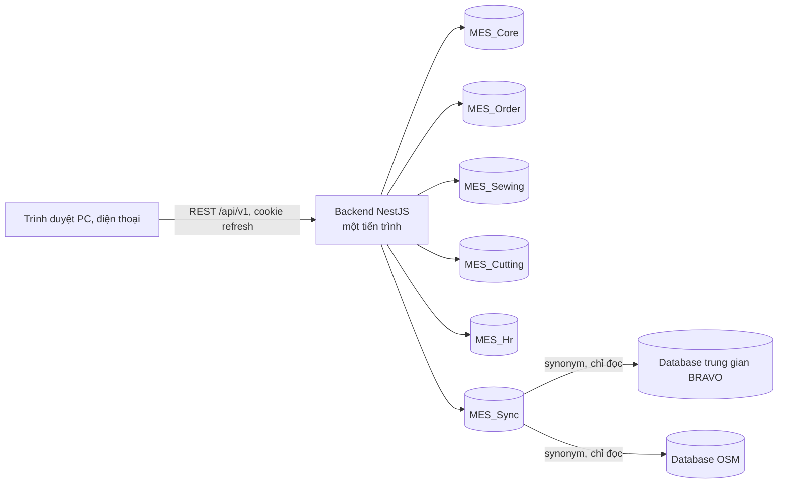

# Tổng quan dự án MES Vietsun

| Mục | Nội dung |
|---|---|
| Mục đích | Cho biết hệ thống là gì, phạm vi nghiệp vụ, công nghệ, thành phần, cấu trúc repo, cách cài và chạy cơ bản |
| Đối tượng | Người mới vào dự án, Tech Lead, AI coding agent |
| Không chứa | Chi tiết kiến trúc ([ARCHITECTURE.md](ARCHITECTURE.md)), luồng dữ liệu ([DATA_FLOWS.md](DATA_FLOWS.md)), luật nghiệp vụ từng màn (tài liệu module ở [update_docs](update_docs/README.md)) |
| Đối chiếu code | Commit `98d19db` trên `main` (19/10/2026) |

## 1. Mục đích hệ thống

MES (Manufacturing Execution System) cho Vietsun, công ty may mặc có nhiều nhà máy. Trục dữ liệu nghiệp vụ:

```
Đơn hàng, PO (BRAVO) → Phân bổ PO cho nhà máy (OSM) → Kế hoạch xuất hàng → Tỷ lệ cắt → Xếp chuyền, phân màu cỡ
  → Chuẩn bị sản xuất → Cắt → May → Endline (QMS) → Hoàn thiện → Đóng thùng → Xuất hàng → Báo cáo
```

- Chạy trên trình duyệt máy tính và điện thoại, cùng một bộ code. Có `manifest.webmanifest` nhưng không có service worker, không chạy offline (`frontend/public/`).
- Dữ liệu gốc về đơn hàng, PO, phân bổ PO nằm ở hệ thống ngoài (BRAVO, OSM). MES chép về và chỉ đọc nguồn, không ghi ngược.
- Dữ liệu phát sinh trong MES (kế hoạch, xếp chuyền, tỷ lệ cắt, chuẩn bị SX, số cắt, cấp BTP, kế hoạch may, nhân sự) do MES quản lý, có nhật ký.
- Phân quyền theo đơn vị cơ sở, chuyền, cột dữ liệu; backend cưỡng chế, giao diện chỉ ẩn/hiện.

## 2. Phạm vi nghiệp vụ

### 2.1 Các khối đang có

| Khối | Màn chính | Code backend | Database | Tài liệu tham chiếu |
|---|---|---|---|---|
| Nền tảng | Đăng nhập, chọn ĐVCS, menu theo quyền, phân quyền 5 lớp, nhật ký, xuất file | `backend/src/platform/*` | `MES_Core` | [04 Phân quyền](update_docs/04-phan-quyen.md) |
| Quản trị | Người dùng, Vai trò, Phân quyền, Chính sách cột, Đơn vị cơ sở, Danh mục hệ thống (gồm Lịch làm việc), Nhật ký, Đồng bộ dữ liệu | `platform/admin`, `platform/catalog`, `platform/sync` | `MES_Core` | [05 Quản trị](update_docs/05-quan-tri-he-thong.md) |
| Đơn hàng | Thông tin đơn hàng, Phân bổ PO, Kế hoạch xuất hàng, Cập nhật tỷ lệ cắt, Xếp chuyền, Phân bổ màu cỡ | `modules/order` | `MES_Order` | [06 Đơn hàng](update_docs/06-don-hang.md) |
| May | Kế hoạch chuẩn bị SX (đặt ở nhóm menu Quản trị đơn hàng), Kế hoạch may | `modules/sewing` | `MES_Sewing` | [07 May](update_docs/07-may.md) |
| Cắt | Đồng bộ tiến độ cắt, Xác nhận cấp BTP | `modules/cutting` | `MES_Cutting` | [15 Cắt](update_docs/15-cat.md) |
| Nhân sự | Sơ đồ tổ chức (chuyền may là bộ phận tích "Xưởng sản xuất"), Thông tin nhân sự, nhập Excel, Loại phòng ban | `modules/hr` | `MES_Hr` | [08 Nhân sự](update_docs/08-nhan-su.md) |
| Đồng bộ | Chép view BRAVO (qua database trung gian) và OSM | `platform/sync`, `platform/feed` | `MES_Sync` | [09 Đồng bộ](update_docs/09-dong-bo.md) |

### 2.2 Menu và màn hình

Menu lấy từ database theo quyền (`SysMenu`, `SysResource`, do `backend/scripts/seed-data.ts` tạo). Màn thật đăng ký ở `frontend/src/routes/registry.tsx` (20 đường dẫn). Đường dẫn có trong menu mà chưa có màn thì hiện trang giữ chỗ (`frontend/src/features/module/ModulePage.tsx`).

| Nhóm menu | Màn thật | Trang giữ chỗ |
|---|---|---|
| Quản trị đơn hàng | `/order/info`, `/order/po-allocation`, `/order/shipment`, `/order/cut-ratio`, `/order/line-plan`, `/order/color-size`, `/order/prep` | – |
| Quản trị nhà cắt | `/cutting/progress`, `/cutting/supply` | `/cutting/embroidery` |
| Quản trị xưởng may | `/sewing/plan` | `/sewing/cluster`, `/sewing/output`, `/sewing/balance` |
| Quản trị chất lượng | – | `/qms/defect`, `/qms/endline`, `/qms/report` |
| Quản trị hoàn thiện | – | `/finishing/plan`, `/finishing/folding`, `/finishing/packing` |
| Quản trị nhân sự | `/hr/org-chart`, `/hr/employees` | – |
| Báo cáo quản trị | – | `/report/prepare`, `/report/progress`, `/report/revenue`, `/report/hourly` |
| Quản trị | `/admin/users`, `/admin/roles`, `/admin/permissions`, `/admin/field-policies`, `/admin/branches`, `/admin/catalogs`, `/admin/audit`, `/admin/sync` | – |

Trang chủ `/` và `/login` nằm ngoài menu. Đường dẫn cũ `/sewing/prep` tự chuyển sang `/order/prep` (`frontend/src/routes/FallbackRoute.tsx`).

### 2.3 Hệ thống ngoài

| Hệ thống | Vai trò | Cách kết nối |
|---|---|---|
| BRAVO (ERP) | Nguồn đơn hàng, PO, màu cỡ, danh mục | Chỉ đọc view của database trung gian (`DB_TRUNGGIAN_NAME`), không đọc thẳng database BRAVO. Chép vào `MES_Sync` khi quản trị bấm Đồng bộ |
| OSM | Nhà máy SX của đơn hàng (`vOSMDataFty`), phân bổ PO theo nhà máy (`v_OSMData`) | Chỉ đọc view, chép vào `MES_Sync` (schema `osm`) |
| GSD | Quy trình, cụm công đoạn, sơ đồ chuyền | Chưa kết nối |
| Hệ thống khác lấy dữ liệu MES | Dòng dàn chuyền đã phân màu cỡ (`GET /api/v1/order/color-size/sync`) | Gọi API của MES bằng tài khoản MES ([13](update_docs/13-quyet-dinh.md) mục 8.6, hướng dẫn ở `docs/tich-hop/`) |
| Hệ thống nhân sự có sẵn của công ty | Không dùng: MES tự quản dữ liệu nhân sự trong `MES_Hr` ([13](update_docs/13-quyet-dinh.md) mục 10.1) | – |

### 2.4 Chưa có

Đã kiểm bằng tìm trong `backend/src`, `frontend/src` và các `package.json`:

- Màn thật của QMS, Hoàn thiện, Báo cáo, Quản lý in thêu, Phân cụm trưởng, Bấm năng suất cụm, Biểu đồ cân bằng chuyền.
- WebSocket, hàng đợi ngoài, lịch tự chạy đồng bộ (`@nestjs/schedule`, cron): không có.
- Kết nối GSD; SSO/AD; ủy quyền tạm thời; luồng phê duyệt.
- Giới hạn tần suất đăng nhập, phát hiện dùng lại refresh token, hạn tuyệt đối của phiên.
- Màn tự đổi mật khẩu; service worker.
- Ánh xạ đơn hàng BRAVO theo đặc tả chính thức của BA (đang dùng giả định tạm ở `backend/src/modules/order/bravo-order.mapping.ts`).

## 3. Thuật ngữ

### 3.1 Tổ chức và dữ liệu theo đơn vị

| Thuật ngữ | Nghĩa |
|---|---|
| **Đơn vị cơ sở (ĐVCS)** | Đơn vị ghi nhận dữ liệu, theo danh mục chi nhánh BRAVO (`DM_CHINHANH`). Bảng `SysBranch`, mã `A01`, `A02`…; cột `BranchCode` của mọi bảng nghiệp vụ là mã ĐVCS. Người dùng chọn một ĐVCS khi đăng nhập, đổi được ở thanh trên. Mã không sửa được |
| **`A00` – đơn vị tổng hợp** | ĐVCS đặc biệt (`SysBranch.IsAggregate = 1`, server tra từ DB). Đọc dữ liệu của mọi ĐVCS **theo phạm vi của phép gán**; không ghi được dữ liệu theo ĐVCS (403 `AGGREGATE_READ_ONLY`), kể cả với vai trò Toàn quyền; không dòng nào mang `BranchCode` của `A00` |
| **Nhà máy SX** | Nhà máy sản xuất thực tế, danh mục `SysProductionFactory`. Mỗi nhà máy gắn **tối đa một** ĐVCS (`BranchCode` có thể `NULL` khi chưa gắn, không được là `A00`). Mã là tên nhà máy theo OSM |
| **Chi nhánh FOB** | Nhãn trên màn cho `BranchCode` của đơn hàng: ĐVCS nhận đơn ở BRAVO, hoặc ĐVCS của người nhập tay |
| **ĐVCS nguồn** | ĐVCS sở hữu một dòng dữ liệu dùng chung (đơn hàng, PO). Đọc được ở mọi ĐVCS, chỉ ĐVCS nguồn ghi được, trừ ngoại lệ có khai báo (`usedBy`) |
| **Chuyền may (Tổ SX)** | Bộ phận tích "Xưởng sản xuất" ở Sơ đồ tổ chức (`MES_Hr.Department.IsProductionWorkshop`), thuộc một ĐVCS. Mã chuyền là mã bộ phận; dữ liệu gắn chuyền qua cột `LineCode` |
| **Chuyền cũ (mồ côi)** | Mã chuyền trên dữ liệu đã xếp mà không còn là bộ phận chuyền nào: giữ mã, hiện "(chuyền cũ)", không nhận việc mới |
| **Phòng ban** | Cây tổ chức của module Nhân sự (`MES_Hr.Department`). Cây `SysOrgUnit` của `MES_Core` chỉ còn nút ĐVCS |

### 3.2 Nghiệp vụ

| Thuật ngữ | Nghĩa |
|---|---|
| **Đơn hàng** (`SalesOrder`) | Một đơn theo mã hàng của khách, chép từ BRAVO hoặc nhập tay. Dùng chung toàn công ty |
| **PO** (`SalesOrderPo`) | Lệnh giao hàng của khách thuộc một đơn hàng, chia theo **màu cỡ** (`SalesOrderPoColorSize`) |
| **Phân bổ PO** | PO, màu nào của đơn nào về nhà máy SX nào, theo OSM (`v_OSMData`); Nhà máy SX sửa tay được và giữ qua các lần đồng bộ |
| **Kế hoạch xuất hàng (KHXH)** (`ShipmentPlan`) | Kế hoạch của một ĐVCS cho một đơn hàng: PO, **SL KHXH** theo màu cỡ, ngày xuất. Mỗi ĐVCS một kế hoạch cho một đơn; mỗi PO chỉ thuộc một kế hoạch |
| **Tỷ lệ cắt** | Số lượng theo màu cỡ của từng PO, xác nhận ở màn Cập nhật tỷ lệ cắt |
| **Xếp chuyền, dàn chuyền** | Gán kế hoạch xuất hàng cho chuyền theo khoảng ngày (`ShipmentPlanLine`); **NSBQ** là năng suất bình quân |
| **Lịch làm việc** | Ngày nghỉ trong tuần, lễ, Tết, làm bù theo ĐVCS (`SysWorkCalendar`); máy chủ dùng để tính ngày dàn chuyền |
| **Kế hoạch chuẩn bị SX** | Các bước chuẩn bị trước ngày vào chuyền (V/C) của từng dòng dàn chuyền: ngày **KH** tính từ V/C, ngày **TH** người dùng nhập |
| **Số cắt, Lũy kế cắt** | Số cắt theo ngày, màu cỡ của một kế hoạch xuất hàng (module Cắt); Lũy kế ghi về cột LK cắt của Kế hoạch xuất hàng |
| **BTP, lệnh cấp BTP** | Bán thành phẩm cấp từ nhà cắt cho chuyền; lệnh cấp gom theo ĐVCS, Ngày cấp, mã hàng, số lệnh `NNN/ddMMyy/XBTP` |
| **Kế hoạch may** | Kế hoạch theo ngày cho từng chuyền từ dòng dàn chuyền; Cập nhật, Chốt, Hủy chốt theo chuyền × ngày |
| **Giá CM** | Đơn giá gia công nhập ở Thông tin đơn hàng; dùng tính Doanh số của Kế hoạch may |

### 3.3 Phân quyền và kỹ thuật

| Thuật ngữ | Nghĩa |
|---|---|
| **Tài nguyên** (`SysResource`) | Một màn hoặc nhóm dữ liệu, mã `module.resource`. Khai `ScopeType` (`BRANCH`/`SHARED`) và bảng nguồn |
| **Quyền** | `module.resource:action`, hành động `view`, `create`, `update`, `delete`, `export` |
| **Vai trò, phép gán** | Tập quyền; phép gán vai trò cho người có phạm vi riêng. **Toàn quyền** (`FULL_ACCESS`) có mọi quyền nghiệp vụ và quản trị nhưng vẫn theo luật `A00` và cấm tự nâng quyền |
| **Phạm vi** | Giới hạn dòng dữ liệu theo phép gán: theo ĐVCS, theo chuyền (mã bộ phận), theo danh sách giá trị, theo người tạo |
| **Chính sách cột** | Mức của từng cột đăng ký: **Ẩn**, **Che** (`***`), **Chỉ đọc**, **Sửa được**; áp cả khi xuất file |
| **Ngoại lệ theo người** | Cho thêm hoặc cấm một quyền với một người, có hạn dùng, bắt buộc lý do |
| **Phiên bản quyền** | Số đếm `SysPermissionVersion` tăng khi quyền đổi, để cache quyền tải lại |
| **`BaseRepository`** | Lớp truy vấn ở `backend/src/platform/data`, tự gắn điều kiện ĐVCS, phạm vi, chặn ghi ở `A00` |
| **Khóa ngầm** | Quan hệ giữa hai database (không có khóa ngoại vật lý), khai ở `backend/migrations/softkeys.json` |
| **Database trung gian** | Database chứa view BRAVO dành cho MES; MES chỉ đọc ở đây |
| **Bảng chép** | Bảng trong `MES_Sync` (schema `bravo`, `osm`) chứa bản chép của view nguồn |
| **Nạp tăng dần** | Bước backend đưa đơn hàng BRAVO đã chép vào `MES_Order` sau mỗi đợt đồng bộ (`BRAVO_ORDER_IMPORT`) |

## 4. Công nghệ

Phiên bản đọc từ `node_modules/*/package.json` đang cài (19/10/2026).

| Phần | Công nghệ | Phiên bản cài | Ghi chú |
|---|---|---|---|
| Runtime | Node.js | 22 (máy chủ chạy Node 22, Tech Lead xác nhận 19/10/2026) | Repo không ghim phiên bản (không có `engines`, `.nvmrc`) |
| Backend | NestJS | 11.2.7 | CommonJS; không nâng NestJS 12 khi chưa chuyển dự án sang ESM |
| Truy cập DB | Kysely + tedious + tarn | 0.28.17, 20.3.3, 3.1.2 | `MssqlDialect`; không nâng Kysely 0.29 (chỉ ESM) |
| Ngôn ngữ | TypeScript strict | 5.9.3 ở `backend`, `frontend` (`nest build`, `tsc`); 6.0.3 ở `node_modules` gốc, `ts-jest` chạy bản này | Đã duyệt chuẩn hóa sang 6.0.3, task T3 ([STATUS](current/STATUS.md)) |
| Xác thực | `@nestjs/jwt`, argon2, cookie-parser, helmet | | |
| Kiểm dữ liệu vào | class-validator, class-transformer | | `ValidationPipe` toàn cục |
| Database | SQL Server 2019/2022 | | Đăng nhập tài khoản SQL; mức tương thích 130+ |
| Frontend | React, Vite, Mantine | 19.3.0, 8.3.4, 9.7.1 | |
| Dữ liệu frontend | TanStack Query, Zustand, React Router | 5.104.1, 5.0.15, 7.18.4 | |
| Lưới nhập | `react-datasheet-grid` | 4.11.6 (ghim) | Bọc ở `frontend/src/components/SheetGrid.tsx` |
| Test | Jest + supertest (backend), Vitest + Testing Library (frontend), `node --test` (deploy) | | Backend test chạy trên SQL Server thật |
| Triển khai | pm2 (cluster một tiến trình), `deploy/deploy.cjs` | pm2 7.0.4 trên máy chủ (theo 11) | |

## 5. Thành phần hệ thống



- Một tiến trình backend phục vụ API; với cờ `--serve-web` phục vụ luôn giao diện đã build (`backend/src/serve-web.ts`).
- Mỗi module nghiệp vụ một database. Chi tiết: [ARCHITECTURE.md](ARCHITECTURE.md).

## 6. Cấu trúc repository

```
backend/                 NestJS
  src/platform/          nền tảng: auth, permission, data (BaseRepository), database, admin, catalog, sync, feed, org, me, audit, export
  src/modules/           nghiệp vụ: order, sewing, cutting, hr
  src/common/, config/   mã lỗi, bộ lọc lỗi; đọc backend/.env
  migrations/<DB>/       migration .sql theo database; softkeys.json
  scripts/               migrate, seed, reset-demo, load-bravo, simulate-board, sync-gen, check-softkeys…
  test/                  Jest *.spec.ts
frontend/                React + Vite
  src/shell/             khung: layout, menu, đổi ĐVCS, guard, phản chiếu quyền
  src/routes/            đường dẫn → màn (nạp lười), trang giữ chỗ, 403/404
  src/features/<khối>/   màn hình: admin, auth, cutting, errors, home, hr, module, order, sewing
  src/components/        thành phần dùng chung (DataGrid, SheetGrid…)
  src/lib/, store/, theme/, perf/, test/
deploy/                  deploy.cjs (triển khai không hạ web), ecosystem.config.cjs (pm2), test
docs/                    tài liệu (file này và các file cùng cấp; current/; update_docs/ tài liệu module)
AGENTS.md, CLAUDE.md     quy tắc cho AI coding agent
```

`frontend/src/modules/` chỉ có `.gitkeep`, không dùng: màn hình nằm ở `frontend/src/features/`.

## 7. Cài đặt, chạy và kiểm tra cơ bản

Yêu cầu: Node.js 22, SQL Server 2019/2022 với tài khoản SQL có `db_owner` trên 6 database (có quyền `CREATE DATABASE` thì migrate tự tạo). Chi tiết biến môi trường, máy chủ: [11 Vận hành](update_docs/11-van-hanh.md).

1. Tạo `backend/.env` từ `backend/.env.example`; tối thiểu `DB_HOST`, `DB_PORT`, `DB_USER`, `DB_PASSWORD`, `JWT_SECRET`, `DEMO_PASSWORD`. Không đưa nội dung `.env` vào tài liệu, chat hay commit.
2. Ở thư mục gốc (các lệnh có trong `package.json`):

```
npm install
npm run migrate          # tạo database nếu được, chạy migration, nạp dữ liệu hệ thống và tài khoản admin
npm run seed             # máy demo: tài khoản demo, dữ liệu mẫu
npm run dev:backend      # http://localhost:3000/api/v1
npm run dev:frontend     # http://localhost:5173 (proxy /api sang cổng 3000)
```

3. Kiểm tra: `npm run lint`, `npm test`, `npm run build`. **`npm test` ghi dữ liệu vào database trong `.env`**: chạy trên bộ database test riêng theo [ENGINEERING_STANDARDS.md](ENGINEERING_STANDARDS.md).

Tài khoản demo (do `seed-data.ts` tạo): `admin`, `quantri`, `giamdoc`, `kehoach.a`, `truongchuyen.a`, `truongchuyen.b`, `ketoan`, `nhansu`; mật khẩu là `DEMO_PASSWORD`. Vai trò, phạm vi từng tài khoản: [12 Dữ liệu mẫu và kiểm thử](update_docs/12-du-lieu-mau-va-kiem-thu.md).

## 8. Phụ thuộc quan trọng

| Phụ thuộc | Vì sao quan trọng |
|---|---|
| SQL Server dùng chung (máy chủ) | `backend/.env` có thể trỏ tới database dùng thật: test, script ghi dữ liệu phải theo chốt chặn ở [ENGINEERING_STANDARDS.md](ENGINEERING_STANDARDS.md) |
| Database trung gian BRAVO, database OSM | Nguồn đồng bộ; khai tên qua `DB_TRUNGGIAN_*`, `DB_OSM_*` |
| NestJS 11, Kysely 0.28 (CommonJS) | Bản kế tiếp chỉ hỗ trợ ESM; thay thư viện truy cập dữ liệu là viết lại `BaseRepository` |
| `react-datasheet-grid` 4.11.6 | Ghim bản; `package.json` gốc có `overrides` cho `react-resize-detector` |
| pm2 trên máy chủ Windows | `deploy/deploy.cjs` dựa vào `pm2 reload`, junction `current` |

## 9. Đọc tiếp

| Cần | Tài liệu |
|---|---|
| Quy tắc bắt buộc khi sửa code | [AGENTS.md](../AGENTS.md) |
| Kiến trúc, ranh giới module | [ARCHITECTURE.md](ARCHITECTURE.md) |
| Luồng đăng nhập, đọc ghi, đồng bộ, xuyên module | [DATA_FLOWS.md](DATA_FLOWS.md) |
| Quy ước code, database | [CODE_CONVENTIONS.md](CODE_CONVENTIONS.md) |
| Test, bảo mật, migration, Definition of Done | [ENGINEERING_STANDARDS.md](ENGINEERING_STANDARDS.md) |
| Quy trình task, review, nhánh, cập nhật tài liệu | [DEVELOPMENT_WORKFLOW.md](DEVELOPMENT_WORKFLOW.md) |
| Trạng thái hiện tại, việc chờ, câu hỏi mở | [current/STATUS.md](current/STATUS.md) |
| Quyết định kiến trúc đang hiệu lực | [13 Quyết định](update_docs/13-quyet-dinh.md) |
| Chi tiết từng module | [Mục lục tài liệu tham chiếu](update_docs/README.md) |
